<div align="center">

# Smart Retry & Flaky Test Detector

### AI-Powered Test Automation, Smart Retry Engine & Flaky Test Observability Platform

Enterprise-grade test observability platform with automated retries, statistical flaky-test scoring, visual test builder, AI root-cause analysis, and executive analytics.

[](https://python.org)
[](https://www.selenium.dev/)
[](https://flask.palletsprojects.com/)
[](https://pytest.org)
[](https://ollama.ai)
[](LICENSE)

<br/>

[Features](#features) • [Screenshots](#screenshots) • [Overview](#overview) • [Flaky Algorithm](#flaky-test-detection--scoring-algorithm) • [Architecture](#system-architecture) • [Test Builder](#visual-test-builder--step-executor) • [Quick Start](#quick-start) • [REST API](#rest-api-reference) • [Contributing](#contributing)

</div>

---

## Screenshots

### 1. Real-Time Analytics Dashboard
**Executive KPI tiles, health indicators, and multi-dimensional Chart.js visualizations**

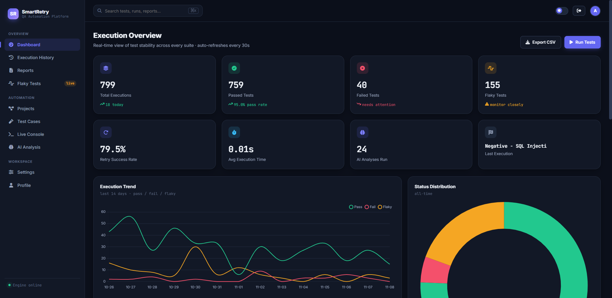

*Live executive dashboard showcasing 8 KPI tiles (Total Executions, Pass Rate, Failed Tests, Flaky Count, Retry Success Rate, Avg Execution Duration, AI Analyses Run, and Last Execution timestamp), a 14-day execution trend line chart, outcome status distribution doughnut chart, and daily retry attempt bar chart with automatic 30-second background polling.*

---

### 2. Flaky Test Intelligence & Stability Verdict
**Statistical sliding-window flip rate, retry-save frequency, and tri-state classification**

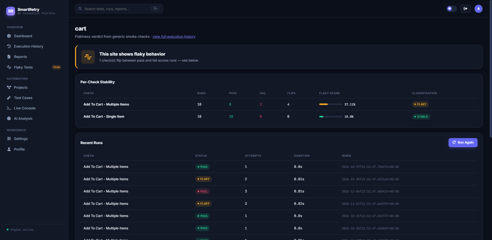

*Flaky test detection engine ranking unstable test cases with flip counts, retry saves, calculated flaky scores, and tri-state stability badges (`STABLE`, `FLAKY`, `CHRONIC_FAILURE`) with one-click re-evaluation and direct links to execution telemetry.*

---

### 3. Multi-Project Portfolio Management
**Dynamic website management with instant URL switching and test execution triggers**

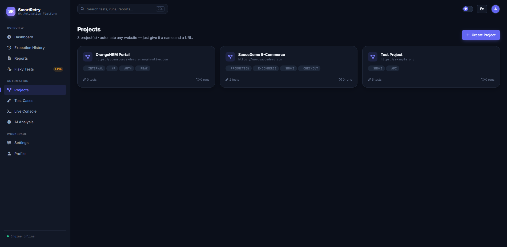

*Comprehensive project portfolio view showing configured web application targets (SauceDemo, OrangeHRM, etc.), base URLs, test case counts, health indicators, and direct actions to execute suites, manage tests, or adjust configurations.*

---

### 4. Project Detail & Test Suite Orchestration
**Project-level test case registry, execution statistics, and run controls**

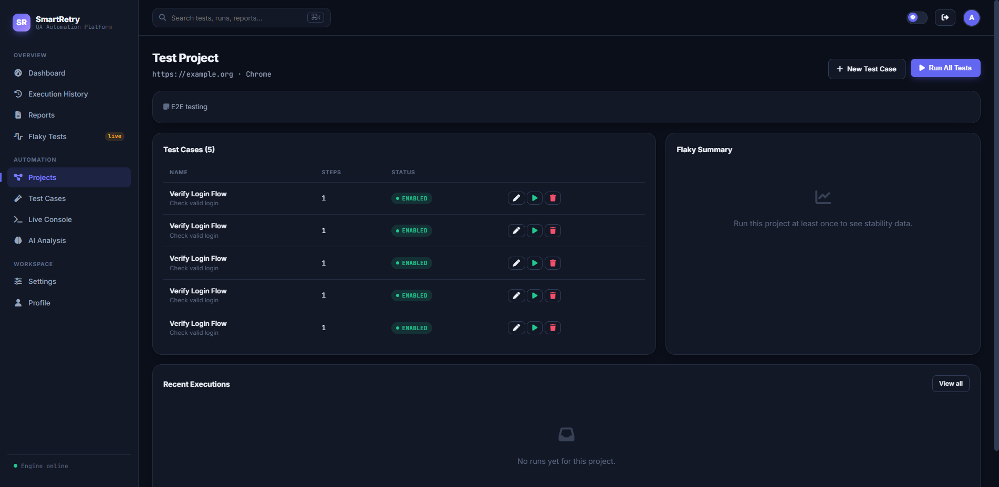

*Project dashboard displaying test case inventories, active/disabled toggle switches, step counts, duration estimates, and single-click suite execution with real-time feedback.*

---

### 5. Low-Code Visual Test Builder
**Drag-and-drop step action sequencer supporting 22 locator-driven browser actions**

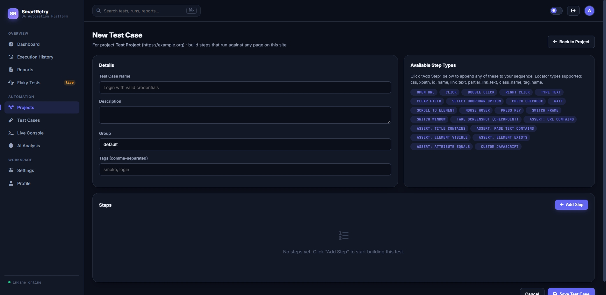

*Visual test builder allowing QA engineers and SDETs to construct robust automated test flows with 22 dynamic step types (navigation, click, type, select, hover, scroll, screenshot checkpoints, and 6 assertion types) without writing boilerplate Selenium code.*

---

### 6. Execution History & Telemetry Table
**Full historical test run audit log with multi-column filtering and CSV export**

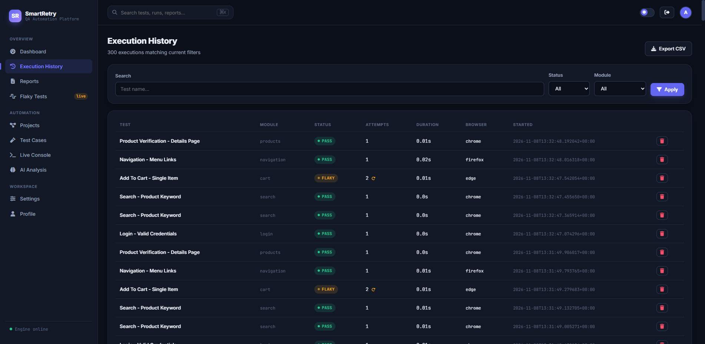

*Detailed execution audit log displaying run IDs, project names, test cases, final outcomes (`PASS`, `FAIL`, `FLAKY`), retry attempt counts, durations, timestamps, and one-click CSV export with advanced filter controls.*

---

### 7. Execution Deep-Dive & Retry Timeline
**Per-attempt telemetry, captured screenshot evidence, and error stack trace inspection**

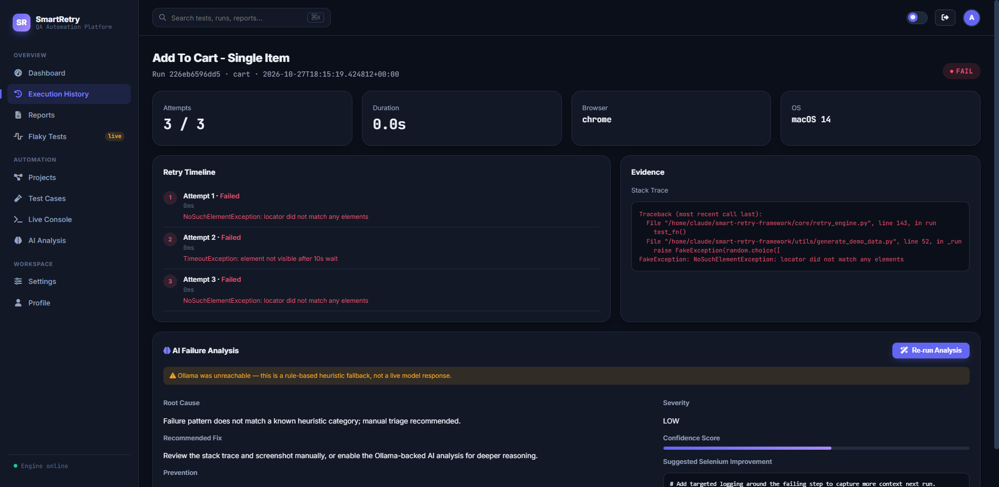

*Deep-dive execution inspection showing exact retry timelines, individual attempt durations, captured error messages, browser console logs, and side-by-side screenshot evidence for root cause analysis.*

---

### 8. AI-Powered Failure Analysis & Triage
**Llama 3.1 root-cause diagnosis, severity ratings, and automated Selenium fix recommendations**

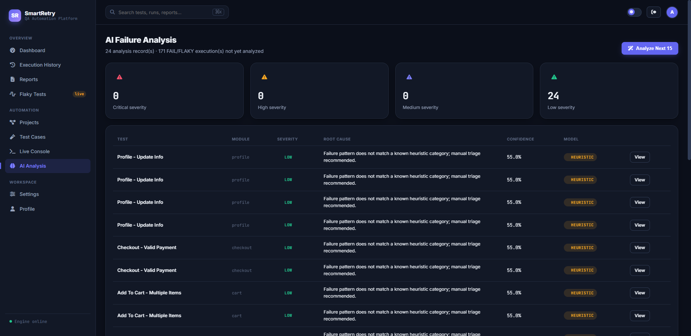

*AI failure analysis engine powered by Ollama Llama 3.1 with intelligent rule-based heuristic fallback, diagnosing stack traces into categorized root causes, severity ratings (`LOW`, `MEDIUM`, `HIGH`, `CRITICAL`), and copy-pasteable Selenium code remedies.*

---

### 9. Live Real-Time Console & Log Streaming
**Live execution streaming with auto-scroll and detailed step-by-step driver output**

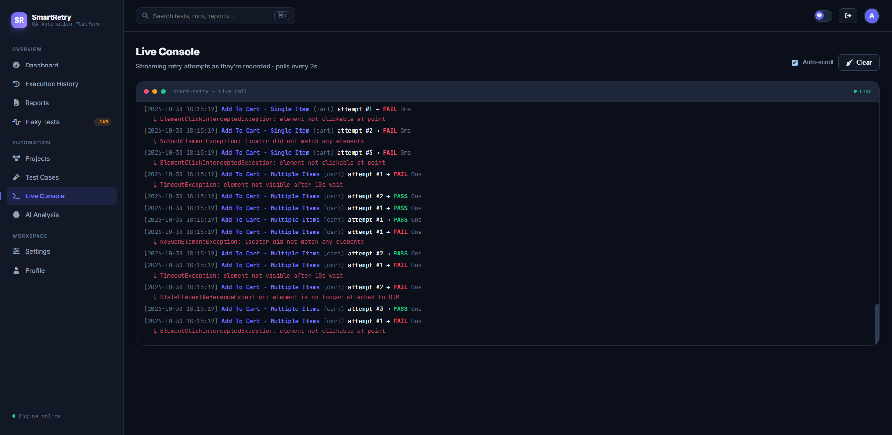

*Live streaming terminal console displaying real-time execution events, driver initialization, step execution progress, retry triggers, and timing metrics.*

---

### 10. Multi-Format Enterprise Reporting Engine
**Self-contained HTML reports, executive PDF downloads, and JSON/CSV data exports**

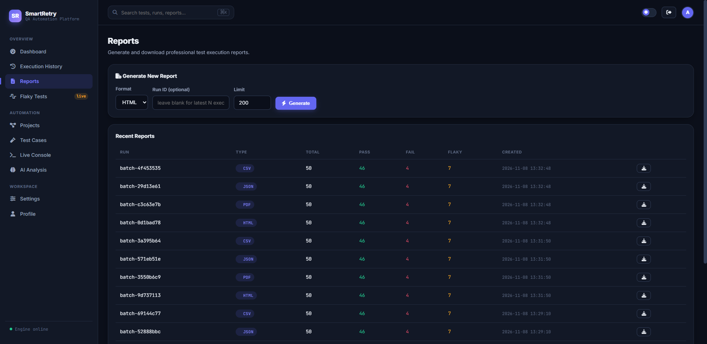

*Enterprise reporting hub supporting on-demand generation and archival of multi-format test reports (self-contained HTML with base64 embedded screenshots, formatted PDF documents via ReportLab, JSON dumps, and CSV summaries).*

---

### 11. Platform Settings & Runtime Engine Configuration
**Fine-grained control over retry counts, backoff multipliers, timeouts, and browser engines**

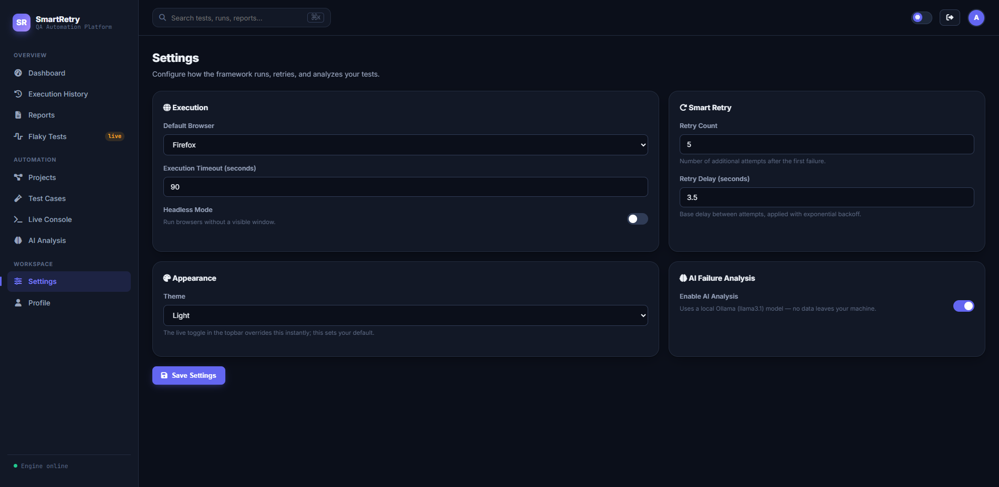

*Centralized runtime configuration management enabling live adjustments to retry limits, exponential backoff delays, flaky score thresholds, headless/windowed browser execution, screenshot triggers, and AI service endpoints.*

---

## Overview

**Smart Retry & Flaky Test Detector** is an enterprise-grade test automation and observability platform designed to solve the multi-billion dollar flaky test problem in modern CI/CD pipelines.

In automated browser testing, intermittent network latency, asynchronous DOM rendering, animations, and transient server blips frequently trigger false-positive test failures. These "flaky tests" break build pipelines, waste hundreds of developer hours diagnosing non-existent bugs, and erode confidence in automated testing suites.

Smart Retry Framework solves this end-to-end:
1. **Intelligent Retries with Exponential Backoff:** Intercepts transient browser exceptions (`StaleElementReferenceException`, `NoSuchElementException`, `TimeoutException`) and retries execution with exponential backoff while capturing per-attempt telemetry.
2. **Mathematical Flaky Scoring:** Rather than treating a test as binary "pass/fail", evaluates historical execution sequences with a weighted algorithm measuring flip rate and retry-save frequency.
3. **AI Root-Cause Diagnosis:** Sends full failure context (stack traces, DOM state, console logs, attempt history) to a local Ollama Llama 3.1 model to generate plain-English explanations and specific Selenium code fixes.
4. **Low-Code Visual Test Authoring:** Empowers QA teams to construct tests for any web application using a 22-step visual builder with zero code requirements.
5. **Real-Time Observability:** Delivers executive KPI dashboards, historical trend charts, live streaming execution logs, and multi-format enterprise reports (HTML, PDF, JSON, CSV).

---

## Features

### 📊 Real-Time Analytics Dashboard
- **8 Executive KPI Cards:** Real-time counters for Total Executions, Pass Rate, Hard Failures, Flaky Count, Retry Success Rate, Avg Execution Duration, AI Analyses Run, and Last Execution indicator.
- **Interactive Visualizations (Chart.js):** 14-day execution trend line chart, outcome status distribution doughnut chart, daily retry average bar chart, and ranked top flaky tests with proportional progress bars.
- **Live Background Refresh:** Non-intrusive 30-second polling updates KPIs and charts in real-time without reloading the page.
- **Dark & Light Mode:** Full responsive theme switching respecting system preferences.

### 🔄 Smart Retry Engine
- **Formula-Driven Execution:** Executes up to `1 + max_retries` attempts per test run with configurable exponential backoff delay.
- **Attempt Isolation:** Each retry attempt runs in a fresh, isolated WebDriver context to avoid state contamination.
- **Retry-Save ROI Metric:** Specifically tracks tests that failed on early attempts but passed on retry, measuring the exact business value and build-time saved.
- **Telemetry Preservation:** Every single attempt's status, duration, error trace, and screenshot are saved independently.

### 🎯 Flaky Test Intelligence
- **Sliding-Window Analysis:** Analyzes a configurable window (default: last 10 executions) to detect behavioral instability.
- **Mathematical Flip Rate (70% weight):** Quantifies how frequently consecutive executions alternate between `PASS` and `FAIL`.
- **Retry-Save Rate (30% weight):** Identifies tests that consistently pass only after consuming retry attempts.
- **Tri-State Classification:** Categorizes test stability into `STABLE`, `FLAKY`, or `CHRONIC_FAILURE` (detecting permanently broken tests vs. intermittent flakiness).
- **On-Demand & Scheduled Evaluation:** Trigger flakiness recalculations via UI button or automated background cron jobs.

### 🛠️ Low-Code Visual Test Builder
- **Dynamic Projects (Any Website):** Not restricted to predefined test sites. Add any web application URL and build custom locator-driven test suites visually.
- **22 Browser Actions:**
  - *Navigation & Windows:* `open_url` (supports relative URLs auto-joined with base URL), `switch_frame`, `switch_window`.
  - *Interactions:* `click`, `double_click`, `right_click`, `type_text`, `clear`, `select_dropdown`, `check_checkbox`, `hover`, `press_keys`.
  - *Timing & Movement:* `wait` (explicit/pause), `scroll_to`.
  - *Evidence:* `screenshot` checkpoint.
  - *6 Assertion Types:* `assert_url_contains`, `assert_title_contains`, `assert_text_present`, `assert_element_visible`, `assert_element_exists`, `assert_attribute`.
  - *Sandboxed JavaScript:* `custom_js` executed strictly inside the browser sandbox via `driver.execute_script`.
- **Test Management:** Reorder steps, clone test cases, toggle active status, and execute single tests or entire project suites.

### 🧠 AI-Powered Failure Analysis
- **Local Ollama Integration:** Analyzes failures using local Llama 3.1 models without sending proprietary code to third-party APIs.
- **Structured JSON Diagnoses:** Generates root cause classification, severity rating (`LOW`, `MEDIUM`, `HIGH`, `CRITICAL`), confidence score, detailed explanation, and copy-pasteable Selenium code fixes.
- **Resilient Heuristic Fallback:** If Ollama is offline or uninstalled, an intelligent regex and rule-based heuristic analyzer automatically triages the failure without breaking the pipeline.

### 📸 Execution Telemetry & Evidence Collection
- **Automated Failure Screenshots:** Automatically captures full-page viewport screenshots on every test failure or checkpoint step.
- **Browser Console Log Capture:** Ingests browser JavaScript console warnings and errors directly from the WebDriver.
- **Hardware & Environment Metadata:** Records OS platform, browser name, driver version, screen resolution, and execution timestamps.
- **Audit Log & CSV Export:** Searchable, filterable execution history table with one-click CSV export.

### 📄 Multi-Format Enterprise Reporting
- **Self-Contained HTML Reports:** Clean, shareable HTML report bundles with base64-embedded failure screenshots requiring no external assets.
- **Executive PDF Reports:** Formatted PDF summaries generated via ReportLab with pass/fail tables, duration charts, and KPI summaries.
- **JSON & CSV Formats:** Machine-readable data exports for CI/CD pipeline integration and external BI tools.

---

## Flaky Test Detection & Scoring Algorithm

The framework uses an empirical, weighted formula evaluated over a sliding window of recent test executions (default: $N = 10$ runs):

```
                                  ┌───────────────────────────────┐
                                  │   Test Execution History      │
                                  │   (Sliding Window: Last N)    │
                                  └───────────────┬───────────────┘
                                                  │
                         ┌────────────────────────┴────────────────────────┐
                         ▼                                                 ▼
            ┌─────────────────────────┐                       ┌─────────────────────────┐
            │   Flip Rate (Weight: 70%)│                       │ Retry-Save Rate (30%)   │
            │   Consecutive Transitions│                       │ Passes Requiring Retry  │
            └────────────┬────────────┘                       └────────────┬────────────┘
                         │                                                 │
                         └────────────────────────┬────────────────────────┘
                                                  ▼
                                  ┌───────────────────────────────┐
                                  │     Composite Flaky Score     │
                                  │      (0.00% to 100.00%)       │
                                  └───────────────┬───────────────┘
                                                  │
                 ┌────────────────────────────────┼────────────────────────────────┐
                 ▼                                ▼                                ▼
       ┌────────────────────┐          ┌────────────────────┐          ┌────────────────────┐
       │      STABLE        │          │       FLAKY        │          │  CHRONIC_FAILURE   │
       │    Score < 20%     │          │    Score >= 20%    │          │  100% Failures     │
       │ Consistent Pass/Fail│          │ Alternating States │          │  >= 3 Consecutive  │
       └────────────────────┘          └────────────────────┘          └────────────────────┘
```

### 1. Flip Rate (70% Weight)
Measures state transitions between consecutive runs (e.g., $P \to F$ or $F \to P$):

$$\text{Flip Rate} = \frac{\text{flip\_count}}{\max(\text{total\_runs} - 1, 1)}$$

*(A test alternating PASS $\to$ FAIL $\to$ PASS $\to$ FAIL across 4 runs has 3 flips out of 3 possible transitions = 1.0 or 100% flip rate).*

### 2. Retry-Save Rate (30% Weight)
Measures tests that eventually passed, but only because they consumed retry attempts:

$$\text{Retry Save Rate} = \frac{\text{retry\_saves}}{\text{total\_runs}}$$

### 3. Composite Flaky Score
$$\text{Flaky Score} = (\text{Flip Rate} \times 0.70 + \text{Retry Save Rate} \times 0.30) \times 100$$

### 4. Tri-State Classification Rules
- **`STABLE`**: $\text{Flaky Score} < \text{threshold}$ (default: $20\%$) and behavior is consistent.
- **`FLAKY`**: $\text{Flaky Score} \ge \text{threshold}$ (default: $20\%$).
- **`CHRONIC_FAILURE`**: Failure rate is $100\%$ across 3 or more consecutive runs (distinguishes outright broken tests from intermittent flakiness).

---

## System Architecture

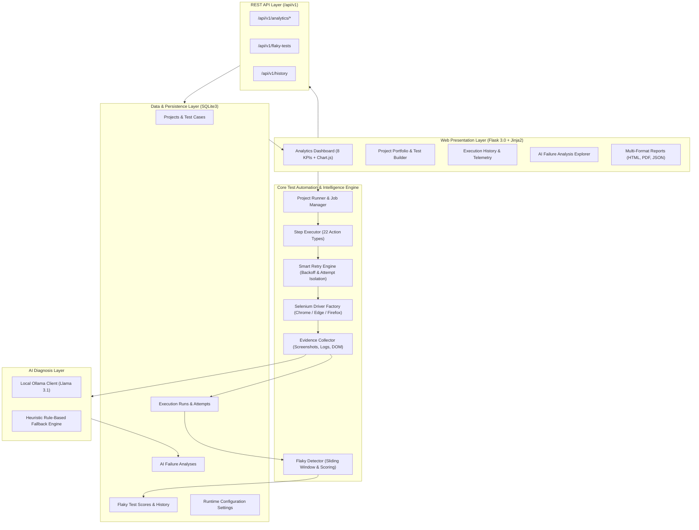

---

## Visual Test Builder & Step Executor

The framework includes a locator-driven low-code step executor in `core/step_executor.py` with 22 dynamic browser actions:

| Category | Action | Parameters | Description |
| :--- | :--- | :--- | :--- |
| **Navigation** | `open_url` | `value` (relative or absolute URL) | Navigates to URL; relative paths auto-prepend base URL |
| | `switch_frame` | `locator_type`, `locator_value` | Switches driver focus into an iframe |
| | `switch_window` | `value` (window title or index) | Switches driver focus to popup or tab |
| **Interactions** | `click` | `locator_type`, `locator_value` | Waits for element clickability and clicks |
| | `double_click` | `locator_type`, `locator_value` | Executes double-click action chain |
| | `right_click` | `locator_type`, `locator_value` | Executes context-click action chain |
| | `type_text` | `locator_type`, `locator_value`, `value` | Types text into input or textarea |
| | `clear` | `locator_type`, `locator_value` | Clears existing input field content |
| | `select_dropdown`| `locator_type`, `locator_value`, `value` | Selects option by visible text or value |
| | `check_checkbox` | `locator_type`, `locator_value`, `value` (true/false) | Sets checkbox checked or unchecked state |
| | `hover` | `locator_type`, `locator_value` | Hovers mouse pointer over element |
| | `press_keys` | `locator_type`, `locator_value`, `value` (e.g. `ENTER`) | Sends special keyboard keys |
| **Timing & Scroll** | `wait` | `value` (seconds) | Pauses execution for explicit delay |
| | `scroll_to` | `locator_type`, `locator_value` | Scrolls viewport until element is in view |
| **Evidence** | `screenshot` | `value` (optional checkpoint name) | Captures visual checkpoint screenshot |
| **Assertions** | `assert_url_contains` | `value` (expected substring) | Verifies current browser URL |
| | `assert_title_contains` | `value` (expected substring) | Verifies current page title |
| | `assert_text_present` | `locator_type`, `locator_value`, `value` | Verifies element contains text |
| | `assert_element_visible` | `locator_type`, `locator_value` | Asserts element is displayed in DOM |
| | `assert_element_exists` | `locator_type`, `locator_value` | Asserts element presence in DOM |
| | `assert_attribute` | `locator_type`, `locator_value`, `attribute`, `value` | Verifies specific element HTML attribute |
| **Scripting** | `custom_js` | `value` (JavaScript code) | Sandboxed in-browser `execute_script` execution |

---

## Quick Start

### 1. Prerequisites
- **Python:** 3.11 or higher
- **Google Chrome:** Any recent version (Selenium Manager resolves drivers automatically)
- **Ollama (Optional):** [ollama.ai](https://ollama.ai) with `llama3.1` model for local AI failure triage

### 2. Clone Repository & Setup Virtual Environment
```bash
# Clone the repository
git clone https://github.com/nayanaastakar/Smart-Retry-Flaky-Test-Detector.git
cd Smart-Retry-Flaky-Test-Detector

# Create virtual environment
python -m venv venv

# Activate virtual environment
# Windows:
venv\Scripts\activate
# macOS / Linux:
source venv/bin/activate

# Install dependencies
pip install -r requirements.txt
```

### 3. Initialize Database & Seed Defaults
Initializes the SQLite schema, runs database migrations, sets up default settings, seeds sample projects (SauceDemo, OrangeHRM), and creates the default admin user:
```bash
python app.py --init-db
```

### 4. (Recommended) Generate Realistic Demo Data
Populates the database with 180 simulated test executions across 12 test profiles to immediately populate the dashboard, charts, flaky detection rankings, and AI analysis views:
```bash
python -m utils.generate_demo_data
```

### 5. Launch the Platform
```bash
python app.py
```

Open your browser at **http://localhost:5000** and sign in:
- **Default Username:** `admin`
- **Default Password:** `Admin@123`

---

## Automated Test Suite

The project includes 25 unit and integration tests covering the retry engine, flaky detection algorithm, step execution, evidence collection, reporting, and Flask API routes:

```bash
# Run full automated test suite
pytest

# Run tests with detailed verbose output
pytest -v
```

All 25 tests run cleanly in ~7 seconds without external dependencies or network access:
```text
============================= test session starts ==============================
platform win32 -- Python 3.12.8, pytest-8.2.2, pluggy-1.5.0
collected 25 items

tests/test_ai_analyzer.py .....                                          [ 20%]
tests/test_analytics.py .....                                            [ 40%]
tests/test_api.py .....                                                  [ 60%]
tests/test_flaky_detector.py .....                                       [ 80%]
tests/test_retry_engine.py .....                                         [100%]

============================== 25 passed in 7.23s ==============================
```

---

## REST API Reference

All API routes return JSON and are registered under the `/api/v1` namespace:

| Endpoint | Method | Query Parameters | Description |
| :--- | :--- | :--- | :--- |
| `/api/v1/health` | `GET` | — | System health status check (`{"status": "ok"}`) |
| `/api/v1/analytics/summary` | `GET` | — | Executive summary metrics (total runs, pass rate, retry ROI, duration) |
| `/api/v1/analytics/status-distribution` | `GET` | — | Categorized outcome distribution (`PASS`, `FAIL`, `FLAKY`, `SKIPPED`) |
| `/api/v1/analytics/execution-trend` | `GET` | `?days=14` | Daily execution metrics timeline for charting |
| `/api/v1/analytics/retry-trend` | `GET` | `?days=14` | Average daily retry attempts per execution |
| `/api/v1/flaky-tests` | `GET` | `?limit=20` | Ranked list of unstable tests with scores and flip counts |
| `/api/v1/flaky-tests/evaluate` | `POST` | — | Triggers full sliding-window recalculation of flaky scores |
| `/api/v1/history` | `GET` | `?limit=50&status=FAIL` | Paginated execution history with filter parameters |
| `/api/v1/history/<id>` | `GET` | — | Complete execution detail including per-attempt telemetry |
| `/api/v1/settings` | `GET` | — | Active runtime configuration key-value map |
| `/api/v1/reports` | `GET` | — | Metadata list of all generated reports |

---

## Project Structure

```text
smart-retry-framework/
├── ai/
│   ├── analyzer.py            # AI failure analyzer with resilient heuristic fallback
│   ├── ollama_client.py       # Local Ollama HTTP client (Llama 3.1)
│   └── prompts.py             # Prompt engineering templates for root-cause triage
├── core/
│   ├── driver_factory.py      # Selenium driver factory (Chrome/Edge/Firefox + Selenium Manager)
│   ├── evidence_collector.py  # Screenshots, console logs, stack traces, browser metadata
│   ├── flaky_detector.py      # Flip-rate and retry-save scoring engine (STABLE/FLAKY/CHRONIC)
│   ├── generic_test_suite.py  # URL-agnostic smoke checks for Quick Run
│   ├── job_manager.py         # Threaded background execution manager with live polling
│   ├── project_runner.py      # Test execution orchestrator
│   ├── retry_engine.py        # Smart retry engine with exponential backoff & telemetry
│   ├── step_definitions.py    # Metadata for 22 visual step builder actions
│   └── step_executor.py       # Runtime step interpreter against Selenium WebDriver
├── database/
│   ├── db_manager.py          # SQLite connection manager & schema migrations
│   └── seed.py                # Initial database seeder (profiles, admin user, settings)
├── docs/
│   └── images/                # 11 High-resolution platform UI screenshots
├── routes/
│   ├── ai_analysis_routes.py  # AI browsing & bulk analysis endpoints
│   ├── api_routes.py          # REST API endpoints (/api/v1/...)
│   ├── auth_routes.py         # Login, logout, session guards
│   ├── console_routes.py      # Real-time console log streaming
│   ├── dashboard_routes.py    # Main analytics dashboard
│   ├── history_routes.py      # Execution history, filters, screenshot serving, CSV export
│   ├── profile_routes.py      # User profile & password management
│   ├── projects_routes.py     # Projects CRUD & test execution
│   ├── reports_routes.py      # Report generation & downloads
│   ├── run_routes.py          # Quick Run execution & live progress
│   ├── settings_routes.py     # Runtime configuration settings
│   ├── test_cases_routes.py   # Test builder, duplication, toggle, edit
│   └── website_profiles_routes.py # Legacy profile management
├── services/
│   ├── analytics_service.py   # SQL aggregation layer for dashboard metrics & charts
│   ├── auth_service.py        # Authentication & PBKDF2 password hashing
│   ├── report_service.py      # Multi-format report generator (HTML, PDF, JSON, CSV)
│   └── settings_service.py    # Single source of truth for runtime database settings
├── static/
│   ├── css/main.css           # Modern dark/light responsive styling
│   └── js/
│       ├── app.js             # Toasts, command palette (Ctrl+K), auto-refresh
│       ├── dashboard_charts.js# Chart.js visualizations
│       └── theme.js           # Instant dark/light theme switching
├── templates/                 # Jinja2 templates for all views
├── tests/                     # 25 automated pytest unit and integration tests
├── utils/
│   └── generate_demo_data.py  # Generates realistic simulated execution history
├── scripts/
│   └── capture_screenshots.py # Headless browser screenshot generator
├── app.py                     # Flask application entry point
├── config.py                  # Central configuration
├── pytest.ini                 # Pytest configuration
└── requirements.txt           # Python dependencies
```

---

## Contributing

Contributions, issues, and feature requests are welcome!

1. Fork the repository
2. Create your feature branch (`git checkout -b feature/amazing-feature`)
3. Commit your changes (`git commit -m "feat: add amazing feature"`)
4. Verify tests pass (`pytest`)
5. Push to the branch (`git push origin feature/amazing-feature`)
6. Open a Pull Request

---

## License

This project is licensed under the MIT License - see the [LICENSE](LICENSE) file for details.
